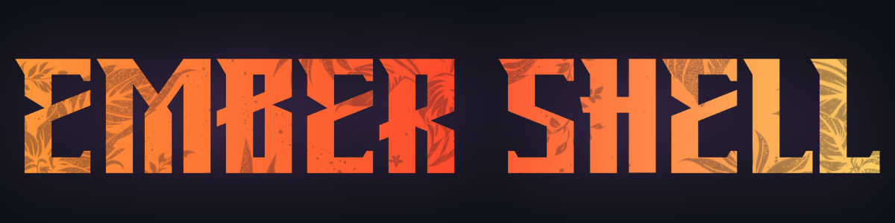

<p align="center"></p>

A warm, low-resource Hyprland rice for everyday laptops.

Ember Shell is a small Hyprland setup designed for 1366x768 displays and larger screens. It keeps the process list short, disables blur by default, and uses a single centered Waybar pill instead of a full-width bar. The palette can follow any wallpaper through Matugen, with sensible fallback colors included.

## Status

- This is experimental and under active development.
- Verified: the config files load without syntax errors, and the Waybar config runs on a live desktop.
- Not yet verified: a full Hyprland session on real hardware, keybinds, Rofi, the scratchpad, and Matugen palette generation.
- Built for Hyprland 0.56 and Arch Linux. Use at your own risk, and back up your `~/.config` first.

<!-- Replace this placeholder with a desktop screenshot at assets/screenshot.png. -->
<p align="center">
  <strong>Screenshot placeholder</strong><br>
  Add a desktop capture at <code>assets/screenshot.png</code>.
</p>

## Features

- Compact Hyprland config with short, non-bouncy transitions and no blur by default.
- Fixed-width Waybar pill, intended to stay centered on 1366x768 and larger displays.
- Matugen palette generation for Hyprland borders, Waybar, Kitty, and Rofi.
- Fallback palettes so the desktop remains usable before Matugen runs.
- Floating scratchpad terminal on `SUPER+U` (untested).
- Rofi launcher on `SUPER+D`, with Matugen colors (untested).
- Keybind cheatsheet generated directly from `hypr/binds.conf` on `SUPER+H`.
- Generic monitor fallback and portable `~` / `$HOME` paths.
- No Hyprland plugins required.

## Requirements

- Hyprland 0.53 or newer.
- Waybar.
- Hyprpaper.
- Kitty.
- Rofi (the plain `rofi` package).
- JetBrainsMono Nerd Font.
- Bash and `grep` for the helper scripts.
- Matugen for automatic palette changes. The included fallback colors work without it.
- PipeWire and WirePlumber for the Waybar volume module.

On Arch Linux:

```bash
sudo pacman -S hyprland waybar hyprpaper kitty rofi ttf-jetbrains-mono-nerd pipewire pipewire-pulse wireplumber
```

Install Matugen with your preferred AUR helper (`matugen-bin`) or from upstream.

## Install

> [!WARNING]
> Back up any existing `~/.config/hypr`, `~/.config/waybar`, `~/.config/kitty`, `~/.config/rofi`, and `~/.config/matugen` first. If you already have a Hyprland setup, merge these files instead of overwriting your configuration.

If you already have ~/.config/hypr/hyprland.lua (a Lua config), move it aside before copying. Hyprland may load both files and the two configs could conflict:

```bash
mv ~/.config/hypr/hyprland.lua ~/hyprland.lua.bak
```

Clone the repository:

```bash
git clone https://github.com/Saaddotcom/ember-shell.git ~/ember-shell
cd ~/ember-shell
```

Copy the config directories:

```bash
mkdir -p ~/.config/hypr ~/.config/waybar ~/.config/kitty ~/.config/rofi ~/.config/matugen
mkdir -p ~/.config/hypr/scripts

cp -r hypr/. ~/.config/hypr/
cp -r waybar/. ~/.config/waybar/
cp -r kitty/. ~/.config/kitty/
cp -r rofi/. ~/.config/rofi/
cp -r matugen/. ~/.config/matugen/
cp -r scripts/. ~/.config/hypr/scripts/

chmod +x ~/.config/hypr/scripts/*.sh
```

Then log out and select Hyprland, or run `Hyprland` from a TTY.

Set a wallpaper and generate the first palette:

```bash
~/.config/hypr/scripts/wallpaper-change.sh ~/Pictures/Wallpapers/ember.jpg
```

With no argument, the script uses `$HOME/Pictures/Wallpapers/ember.jpg`. It updates Hyprpaper, runs Matugen, and reloads Waybar, Kitty, and Hyprland through Matugen's post-hooks.

The `zsh/zshrc.additions` file is an empty, optional append-only placeholder. Use it only if you want shell additions; the desktop does not require it.

## Keybindings

Press `SUPER+H` to open the cheatsheet. It is generated at runtime from `hypr/binds.conf`, so there is no second keybind list to keep in sync. Edit `binds.conf` and the cheatsheet follows.

## Customization

- Change `$mainMod`, `$terminal`, or `$blur` in `hypr/hyprland.conf`.
- Change monitor behavior in `hypr/monitors.conf`. The default rule auto-detects connected displays.
- Change gaps, borders, opacity, and blur behavior in `hypr/looks.conf`.
- Change workspace, window, and layer rules in `hypr/rules.conf`.
- Change the Waybar layout in `waybar/config.jsonc` and `waybar/style.css`.
- Change the Rofi layout in `rofi/config.rasi`, and the launcher colors in `matugen/templates/rofi.rasi`.
- Change terminal behavior in `kitty/kitty.conf`.
- Change Matugen outputs and reload hooks in `matugen/config.toml`.

The fallback palette files are overwritten when Matugen runs:

- `waybar/colors.css`
- `hypr/colors.conf`
- `kitty/colors.conf`
- `rofi/matugen.rasi`

## Structure

```text
hypr/       Hyprland entry point, binds, rules, surfaces, and animations
waybar/     Pill-style Waybar layout and placeholder colors
kitty/      Terminal config and placeholder colors
rofi/       Launcher theme and placeholder colors
matugen/    Palette templates and output configuration
scripts/    Wallpaper, scratchpad, and generated cheatsheet helpers
zsh/        Optional append-only shell additions
```

## Notes

- Window rules are written for the Hyprland 0.53+ `windowrule` syntax and are not yet verified on 0.56.
- The plain `rofi` package may need XWayland on some builds. This is unverified on Rofi 2.0.
- The scratchpad and cheatsheet helpers assume Kitty, even if `$terminal` is changed for normal terminal launches.
- The cheatsheet prefers `less` for scrolling and falls back to a static view.
- Matugen is optional, but the fallback palette will not follow wallpaper changes.

## Originality

Ember Shell is an original project. Its layouts, fallback palettes, scripts, and documentation were written for this repository; it does not bundle another person's rice. Common Hyprland and Wayland conventions are, of course, shared across the ecosystem.

## License

MIT. See [LICENSE](LICENSE).
